<div align="center" id = "top">
  
</div>

# Nerthus

Nerthus is a clean room reimplementation of Gaea 2.0, the node-based terrain
generator, written in Rust. It opens and saves Gaea 2 `.terrain` projects, and
projects it saves open in Gaea 2.3.1.0. Its goal is to build them into the
same heightfields, masks and colour maps that Gaea does.

Nerthus is an independent project. It is not affiliated with or endorsed by
the makers of Gaea.

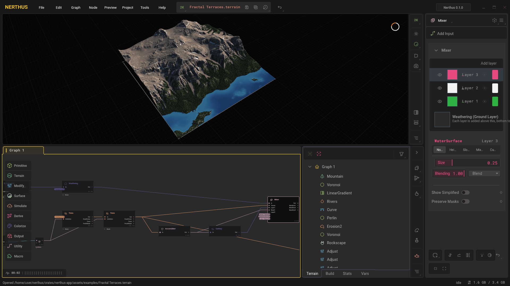

## A look around

A terrain is built as a graph of nodes. The viewport shows the selected node in
3D as it builds, and the property panel beside it changes the node's settings.
Most terrains take the same few steps: a shape to start from, simulations that
wear it down, detail on its surface, then colour.

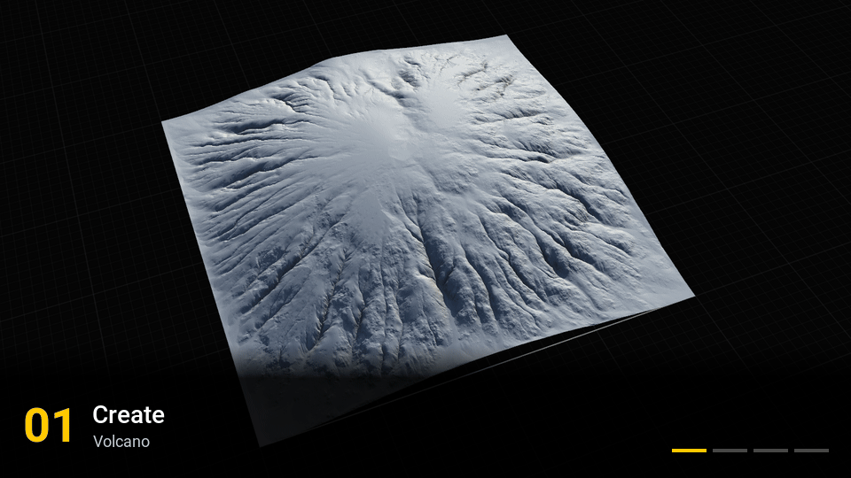

### Create

Primitives and terrain nodes make the first shape: mountains, ranges, ridges,
canyons, volcanoes, islands, dunes, craters and noises.

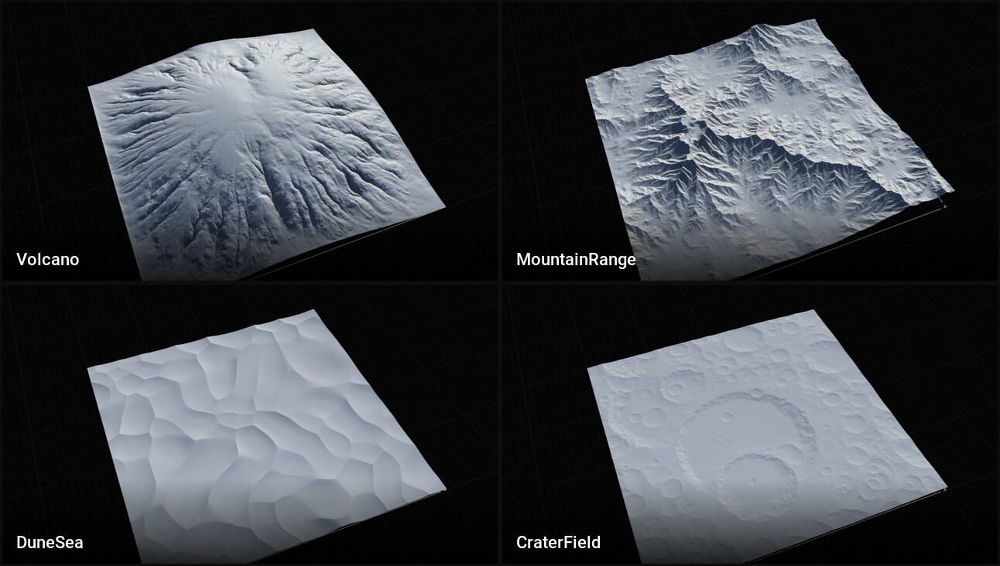

### Simulate

Erosion, rivers, lakes, the sea, thermal erosion, snow and glaciers work the
shape over.

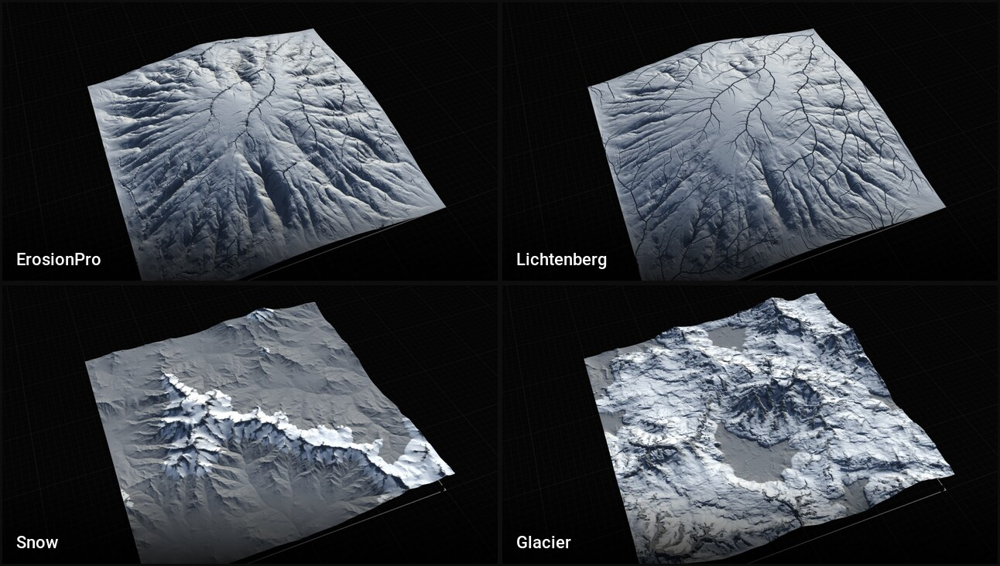

### Surface

Surface nodes add the rock: strata, terraces, sandstone, shattered stone and
outcrops.

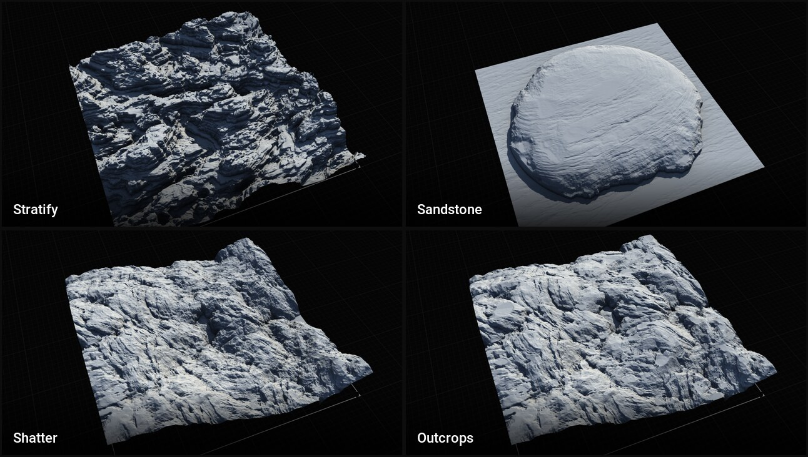

### Colorize

Colour nodes paint the terrain from palettes, gradients and the masks the
other nodes make.

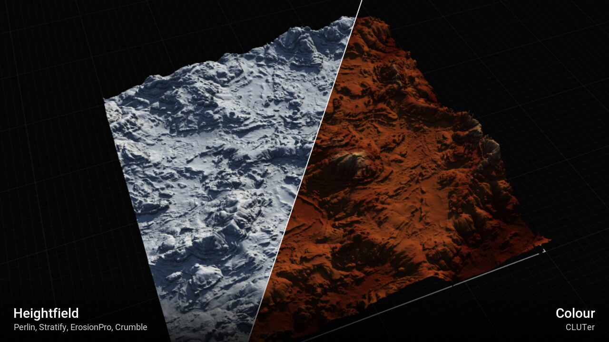

### Export

Build and Export writes the nodes marked for export as heightfields, masks and
colour maps (EXR, PNG, TIFF, JPEG or RAW), as one image each or as tiles.

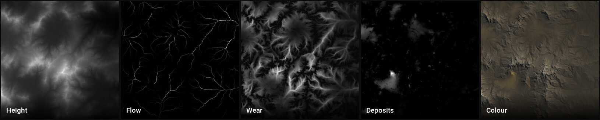

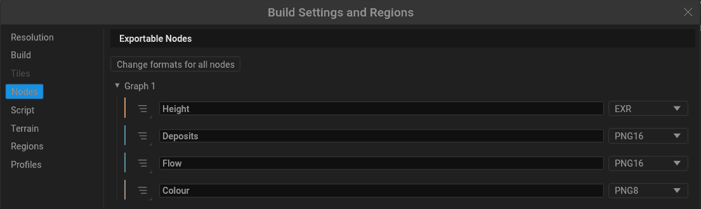

### Examples

File › Open Examples… opens one of the 16 example projects Nerthus comes with.

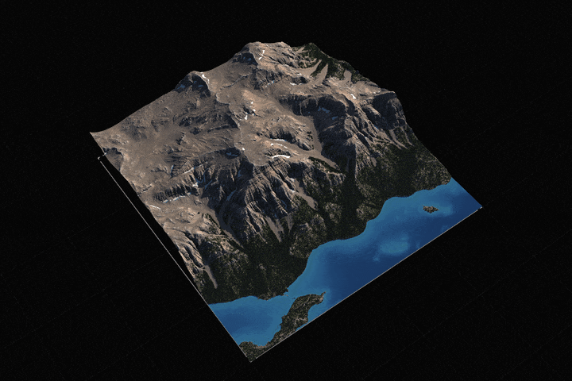

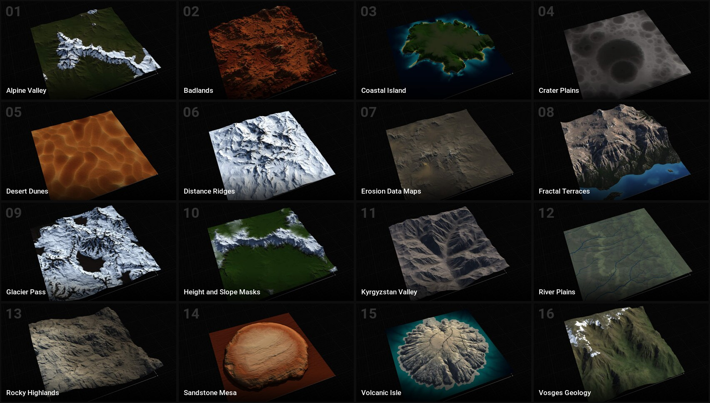

## Building

Nerthus needs Rust 1.99 or newer. It is developed on macOS; Windows and Linux
builds are untested.

```sh
cargo build --release
```

## Running

The editor:

```sh
cargo run --release --bin nerthus -- path/to/project.terrain
```

`nerthus --help` (or `-?`) lists the editor's options, such as `--no-start`
to skip the Start dialog, `--safe-mode` to start with the default
preferences and options, and `--proxy <url>` to set the proxy used for
update checks.

Command-line builds:

```sh
cargo run --release --bin nerthus-build -- build path/to/project.terrain
```

Builds go to a new numbered folder under `Documents/Nerthus/Builds/<project
name>/` unless the project's Build Settings say otherwise. Each run writes a
log to `Logs` in the Nerthus user folder (`~/.nerthus`, or
`%LOCALAPPDATA%\Nerthus` on Windows); `--verbose` adds the debugging
messages, and `--safemode` builds with the default preferences instead of
the saved ones. Run `nerthus-build --help` for the other commands and
options.

For many builds in a row, `nerthus-build host` keeps a build host loaded
between them: the first run starts it, later runs hand their project and
options to it and print its output, and `nerthus-build host --exit` closes
it.

## Web version

The editor also runs in a browser with WebGL 2. The Web workflow builds it
for every pull request and publishes main's with GitHub Pages, at
<https://danemadsen.github.io/nerthus/>.

To build it yourself, add the WebAssembly target and the `wasm-bindgen`
command of the version in `Cargo.lock`, then run the build script, which
writes the site to `target/web`:

```sh
rustup target add wasm32-unknown-unknown
cargo install wasm-bindgen-cli --version <version in Cargo.lock> --locked
crates/nerthus-app/web/build.sh
python3 -m http.server --directory target/web
```

A web page has no files, threads or other programs to use, so the web
version differs from the desktop one:

- Nodes build on the CPU alone and on the page's one thread, a node at a
  time between frames, so builds take longer.
- Projects are the examples it comes with and files you pick with Open;
  saving downloads the project. Settings, recent files and autosaves are
  not kept between visits.
- Build and Export, baking and the disk cache, screenshots and turntables,
  importing files, installing and exporting macros, loading and saving
  cameras, File nodes reading from disk, Diagnostics, update checks and the
  MCP server are left out.

## MCP server

The editor can run an [MCP](https://modelcontextprotocol.io) server, so AI
assistants such as Claude Code can work on the open project: add and connect
nodes, set parameters, build nodes and look at the results, and run Build and
Export. Their edits show in the editor as they happen and can be undone.

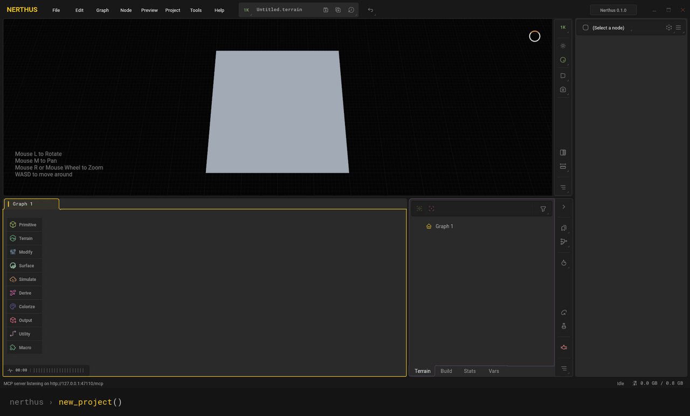

Turn it on with Tools › MCP Server (it stays on for later starts), or start
the editor with `--mcp`. It listens on `http://127.0.0.1:47110/mcp`;
`--mcp-port <port>` picks another port. To connect Claude Code:

```sh
claude mcp add --transport http nerthus http://127.0.0.1:47110/mcp
```

The server only takes connections from this machine and has no other
authentication, so while it is on, any program running on this machine can
use it.

Its tools:

- **The project**: `get_project`, `open_project`, `new_project`,
  `save_project`, `set_project_settings`, `list_variables`, `set_variable`.
- **Node types**: `search_node_types`, `describe_node_type` (with how the
  example projects use each type and what `calibrate_nodes` measured it to
  make), `describe_modifier`, `suggest_nodes`. Types can also be named as
  `.terrain` files name them (`Erosion2` for ErosionPro, `SatMap` for
  SatelliteMap).
- **Building graphs**: `create_graph` (a whole graph of nodes, modifiers,
  export marks and connections as one undoable edit), `list_examples`,
  `open_example`, `add_node`, `set_parameters`, `update_node`,
  `connect_nodes`, `disconnect_input`, `delete_nodes`, `set_modifier`,
  `undo`, `redo`.
- **Checking graphs**: `list_nodes`, `get_node`, `select_node`,
  `validate_graph` (the open project, a file or a proposed graph; it can fix
  what is safe to fix and build it small to be sure), `analyze_graph`,
  `optimize_parameters`.
- **Building and looking**: `build_node`, `get_node_image`, `capture_view`,
  `set_camera`, `export_node_map`, `mark_for_export`, `build_and_export`,
  `run_project` (any saved project, with the command line's options:
  resolution, build folder, profile, region, mutation seed, variables, one
  node), `build_history`, `analyze_build`, `analyze_terrain` (relief in
  metres, gentle ground, edges against the middle, profiles),
  `calibrate_nodes`.
- **Project files**: `get_project_file`, `list_projects`,
  `repair_project_file`, `patch_project_file`, which change a `.terrain`
  file without opening it in the editor.

## Not done yet

These parts of Gaea 2.0 are not in Nerthus yet.

### Graph

- Shift-clicking a node while another is selected doesn't select the nodes
  that connect the two. Nerthus adds or removes the clicked node, as
  Ctrl-click does.
- Shift with the arrow keys doesn't nudge the selected nodes (Gaea moves
  them 10 units a press).
- Refresh (F5 and the node menu) and Reset (Ctrl R) change only the active
  node, not every selected one, and the graph toolbar's Refresh doesn't
  refresh every node when none is selected.
- Ports have no tooltips. Gaea shows a port's name there, with "(Required)"
  on required inputs, which matters on compact and small nodes because they
  hide their port labels. Node tooltips set out the name, build time and
  status differently.
- Notes render only the headings and bullet points of their Markdown. Bold,
  italics, links, numbered lists, tables and code show as plain text in the
  note, its tooltip and the Note Editor's preview.
- The Undo menu names many steps differently: Gaea writes "Mountain: Height
  0.5 → 0.7" and "Connection: Mountain-Out ⇢ Erosion-In" where Nerthus
  writes "Change Height" and "Connect". It also has no icons for the kinds
  of step and no separators between runs of edits to one thing, and it
  lists the latest 20 steps instead of all of them.
- After an undo, the status bar doesn't say what was undone ("Undid: …").
  After a refresh, it doesn't say which node was refreshed.
- Builds report less of their progress. Nodes don't report how far they
  have got, so the graph footer has no progress line for the building node
  and no row of dots for the build's nodes. Nerthus shows one bar of nodes
  finished instead. The status bar doesn't show Gaea's progress messages,
  such as "Simulating cascade 03 of 10" (Snowfield) and "Rendering pass 2
  of 5" (Sediments). The footer's status icon only changes colour while a
  build runs, where Gaea swaps in its own icons for building (animated), a
  suspended engine and cancelling. The pointer doesn't show as busy while a
  build runs.

### Properties

- Colour properties, colour variables and the background in Options ›
  Viewport use a stock colour picker. Gaea's is a swatch that opens a
  square of saturation and brightness over a hue bar.
- The gradient editor of CLUTer and Synth isn't Gaea's. Gaea shows a
  96-pixel black strip of colour stops above the same kind of picker.
  Clicking the strip adds a stop in the colour under it, dragging a stop
  past either end removes it, the left and right arrow keys move the chosen
  stop by 0.01, and Delete removes it.
- Mixer's layer list can't change a layer's colour, which a layer without
  an input (or a simplified one) builds with. It doesn't show thumbnails of
  the layers' inputs or the ground layer's, and it can't reorder layers by
  dragging them.
- The Add Modifiers menu offers Clip, Match Height, Mask by Height and Mask
  by Slope on colour nodes. Gaea disables them there.
- TextureBaker and MeshWarp don't list the files they will write, and
  TileInput doesn't sum up the tiles it found (how many, how they're laid
  out, their size, folder and extension).

### Viewport

- Escape doesn't end picking or measuring in the 2D viewport. Nerthus uses
  Enter.
- Dragging the rotate handle of a 2D viewport gizmo doesn't wrap the
  pointer from the top of the screen to the bottom and back.
- The sky (Show Skybox) approximates the higher scattering orders of Gaea's
  precomputed atmosphere, so its colours differ slightly.

### Menus and windows

- Menus have no access keys. Gaea's open with Alt and the underlined letter
  (Alt F for File), and in the Lazy Menu F1 followed by 1, 2 or 3 switches
  the renderer.
- Build Settings › Terrain doesn't show the terrain's real scale (metres
  per pixel at the build resolution) or its height-to-width ratio.
- About fifteen of Gaea's message boxes are drawn as plain boxes, without
  the Windows task dialog's layout that the other prompts copy. Examples are
  the ones for deleting a graph tab or every variable, cleaning up
  artifacts, optimizing memory, the Nahimic warning and the update check.
- Run Diagnostics has no Run in Safe Mode task. It has no High Accuracy (20
  passes) or Very High Accuracy (50 passes) benchmark, and no warning when
  a newer version is known. Its packages leave out the hardware report, the
  list of the program's files and the running processes. Once a package is
  made, there is no package viewer and no copy to the desktop.

### Files

- Some images the File node reads differently from Gaea:
  - EXR files with subsampled channels (luminance/chroma images, for
    example) don't open.
  - TIFF files compressed with old-style JPEG don't open.
  - MIFF files in a colorspace other than sRGB, linear RGB, grey, CMYK, Lab
    or XYZ (HSL, for example) don't open.
  - SVG drawings are drawn by resvg rather than librsvg and cairo, so their
    edges are antialiased a little differently.
  - Animated WebP files don't open. Gaea reads their first frame.
  - Camera raw files other than DNG (CR2, CR3, NEF, ARW, ORF, RAF, RW2 and
    so on) don't open, and neither do a few rarer DNGs, such as Fuji
    SuperCCD ones.
  - Of the other formats ImageMagick reads, only TGA opens. It goes through
    a general-purpose decoder at 8 bits per channel, so its pixels can
    differ. PNM and PFM, ICO, PCX, QOI, HEIC, AVIF, JPEG XL and the rest
    don't open.

### Builds

- On ARM computers such as Apple Silicon Macs, white noise made from
  undefined (NaN) positions comes out differently from Gaea's, because ARM
  and x86 processors give NaNs different bits.

### Left out on purpose

- Licensing.
- The Houdini, Unity and Unreal bridges: the HoudiniOut, Unity and Unreal
  nodes, the File and Export nodes' Prepare for Bridge buttons, Create
  Connected Nodes › For Plugins, and Tools › Install Plugins.
- Features Gaea ships disabled or unfinished, such as Network Build.
- Drawing Windows metafiles (`.emf`) exactly as Windows does. Nerthus draws
  them itself, so edges and text differ slightly, and fonts that aren't
  installed are replaced by similar ones.
- Reading EPS files. Gaea hands them to Ghostscript, a separately installed
  program that draws them with its own fonts.
- Gaea's interface fonts. Nerthus uses Roboto and Roboto Mono, so text is
  spaced a little differently and monospaced text is about a fifth wider.
- The icons that are Gaea's own or licensed artwork, about 100 of them
  (45 node icons, 13 family and toolbox icons, and interface icons).
  Nerthus shows Tabler icons in their place.
- Gaea's overlay images and example projects. Nerthus draws its own overlay
  patterns and ships 16 examples: 12 made for Nerthus and 4 contributed
  under the MIT licence.
- Gaea's colour library. Nerthus's palettes are its own, taken from
  Sentinel-2 satellite imagery to look like Gaea's palette with the same
  number, so SatelliteMap, SuperColor, Cartography through a SatelliteMap,
  and Weathering build with somewhat different colours from Gaea's, and
  TextureBase with New accentuation builds a somewhat different mask
  (Weathering and TextureBase read Rock palette 117). Projects saved by Gaea
  keep their palette numbers.

## License

MIT (see [LICENSE](LICENSE)). The Roboto and Roboto Mono fonts in
`crates/nerthus-app/assets/fonts` are under the Apache License 2.0, with their
licence texts beside them. The palettes in `crates/nerthus-nodes/data/color`
contain modified Copernicus Sentinel data 2023–2024; the
[README](crates/nerthus-nodes/data/color/README.md) beside them says where
each one comes from.

The documentation in `crates/nerthus-app/assets/docs` (Help › User Guide) is
adapted from Gaea 2's documentation, which is published under the MIT licence;
its licence text is in `crates/nerthus-app/assets/docs/LICENSE.txt`.

Four of the example projects in `crates/nerthus-app/assets/examples`
(Distance Ridges, Fractal Terraces, Kyrgyzstan Valley and Vosges Geology) were
contributed to Nerthus under the MIT licence.
